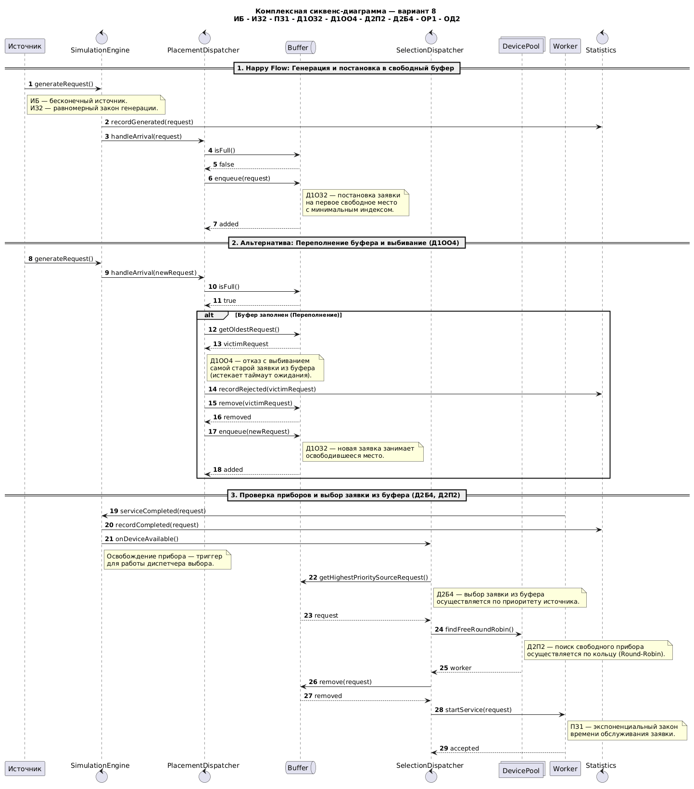

# Моделирование Системы Массового Обслуживания (СМО) — Вариант 8

> Имитационная модель многоканальной системы массового обслуживания с буферизацией, приоритетами источников и вытеснением старых заявок.


## Спецификация варианта № 8

| Код | Элемент СМО | Значение в варианте |
| :--- | :--- | :--- |
| **ИБ** | Источники заявок | Бесконечные источники заявок |
| **ИЗ2** | Закон генерации | Равномерный закон распределения интервалов |
| **ПЗ1** | Закон обслуживания | Экспоненциальный закон времени обслуживания |
| **Д1ОЗ2** | Постановка в буфер | Поиск первого свободного места с наименьшим индексом (`min index`) |
| **Д1ОО4** | Дисциплина отказа | При переполнении буфера выбивается **самая старая** заявка (`oldest`) |
| **Д2П2** | Выбор прибора | Выбор свободного прибора по кольцу (`Round-Robin`) |
| **Д2Б4** | Выбор заявки из буфера | Приоритет по источнику (меньше ID источника — выше приоритет) |
| **ОР1 / ОД2** | Отчетность и режим | Сводный табличный отчет и пошаговый календарь событий |


1. **Штатная доставка**: Заявка генерируется и записывается в первое свободное место буфера (Д1ОЗ2).   
2. **Переполнение**: Если буфер полон, самая старая заявка выбивается с фиксацией отказа (Д1ОО4).   
3. **Обслуживание**: При освобождении прибора из буфера забирается приоритетная заявка (Д2Б4), которая отправляется на прибор по кольцу (Д2П2) для обработки (ПЗ1).
---
## Структура проекта

Проект спроектирован на основе принципов объектно-ориентированного программирования (ООП) и разделен на независимые модули:

```text
course-work-smo/
├── programm_smo/       # Исходный код программы (Python)
│   ├── models.py       # Сущности данных (Request)
│   ├── source.py       # Генераторы заявок (ИБ, ИЗ2)
│   ├── buffer.py       # Управление буфером (Д1ОЗ2, Д1ОО4, Д2Б4)
│   ├── device.py       # Приборы / воркеры (ПЗ1)
│   ├── simulation.py   # Оркестратор событий и диспетчер (Д2П2)
│   └── main.py         # Точка входа для запуска пошагового режима
├── diagrams/           # UML-диаграммы (Class, Sequence, Flowchart)
└── docs/               # Отчеты и текстовые материалы по этапам
```

---
## Основная логика СМО (Варинат 8)

```text
Источник
   |
   v
SimulationEngine
   |
   v
PlacementDispatcher (Д1ОЗ2 / Д1ОО4)
   |
   v
Buffer
   |
   v
SelectionDispatcher (Д2Б4 — по приоритету источника)
   |
   v
DevicePool
   |
   v
Worker (ПЗ1 — экспоненциальное обслуживание)
   |
   v
Round-Robin (Д2П2 — кольцевой выбор прибора)
```